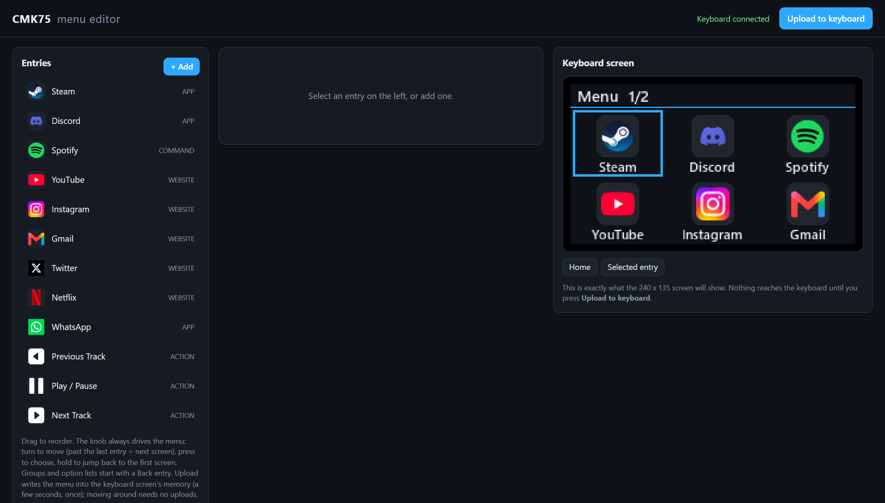

<div align="center">


**CMK75 키보드의 화면과 노브를 Stream Deck 스타일 런처로 바꿔 보세요.**

[](LICENSE)


[English](README.md) · [Türkçe](README.tr.md) · [简体中文](README.zh-CN.md) · [Русский](README.ru.md) · **한국어**

</div>

---

<p align="center"></p>

## 이게 뭔가요?

CMK75에는 240×135 크기의 작은 화면과 회전 노브가 있습니다. 이 프로젝트는 브라우저에서 메뉴를 디자인해
그 화면에 표시해 줍니다. 노브를 돌려 이동하고, 눌러서 실행하고, 길게 누르면 첫 화면으로 돌아갑니다.

- **드래그 앤 드롭 편집기:** `http://127.0.0.1:8475/`, 실제 화면과 똑같은 실시간 미리보기
- **항목 종류:** 앱, 웹사이트, 폴더, 파일, 명령, 내장 동작, 중첩 그룹
- **동작:** 실행 또는 전환, 열기, 지정한 브라우저로 열기, 닫기, 음소거, 볼륨, 단축키 전송
  (예: Discord 마이크/헤드셋 음소거)
- **사용자 지정 아이콘과 색상**, 테마 색상, 선택형 시계 동기화
- **메뉴를 화면 칩에 저장**하므로 이동할 때 다시 업로드할 필요가 없습니다 (패치된 화면 펌웨어 필요, 아래 참고)
- **복구 도구:** 업데이트 후 화면이 꺼지면 화면 칩을 다시 플래시합니다

## 빠른 시작

> Windows 10/11, USB로 연결된 CMK75, Python 3.11 이상.

```powershell
git clone https://github.com/atahan26/cmk75-menu-editor
cd cmk75-menu-editor
py -3.11 -m venv .venv
.venv\Scripts\python.exe -m pip install -r requirements.txt
.venv\Scripts\python.exe menu_app.py
```

편집기가 브라우저에서 열리고, 처음 실행하면 예시 메뉴가 만들어집니다. **Upload to keyboard** 버튼을 누르기
전에는 키보드에 아무것도 전송되지 않습니다. 종료는 `Ctrl+C`입니다.

## 중요: 패치된 화면 펌웨어

메뉴를 칩에 저장하는 모드에는 **패치된 화면 펌웨어(v17 이상)**가 필요합니다. 제조사 펌웨어 파일은 키보드
제조사의 소유이므로 여기서 **배포하지 않습니다.** `tools/build_patch.py`는 **본인의** 제조사 화면 펌웨어
파일을 읽어 패치된 사본을 만들고, `tools/recover_screen.py`가 이를 플래시합니다. 고급 사용자용입니다.
플래시하면 화면이 응답하지 않게 될 수 있습니다. 코드를 읽어 보고, 먼저 백업하고, 본인 소유의 키보드에서
본인 책임으로 사용하세요.

## AI 에이전트와 함께 사용하기

클론한 폴더에서 연 Claude Code, Codex, Cursor 등 코딩 에이전트에 아래 블록을 붙여 넣으세요.

```text
Read AGENTS.md and README.md in this repository first. This is a Windows tool for the CMK75
keyboard screen and knob. Help me with: <원하는 작업>. Follow the safety rules in AGENTS.md.
Do not run tools/recover_screen.py or tools/build_patch.py or flash anything without asking me first.
```

## 프로젝트 소개

개인 프로젝트입니다. 작성자가 목표를 정하고, 공개된 분해 사진으로 키보드의 칩을 확인했으며, 모든 버전을
실제 장치에서 테스트했습니다. 프로토콜 작업과 펌웨어 빌드를 포함한 코드는 대부분
[Claude Code](https://claude.com/claude-code)가 작성했습니다. 키보드에 사용하기 전에 코드를 직접 검토하세요.

## 라이선스

[MIT](LICENSE). 키보드 제조사와 무관하며, 제조사의 승인이나 후원을 받지 않았습니다.
모든 제품 이름은 각 소유자의 것입니다.
