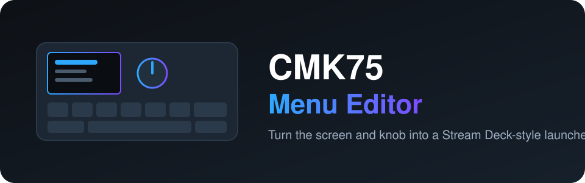
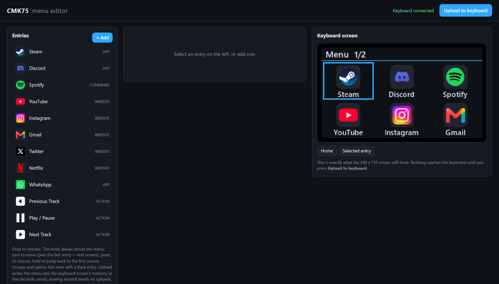

<div align="center">



**Turn the screen and knob of a CMK75 keyboard into a Stream Deck-style launcher.**

[](LICENSE)


**English** · [Türkçe](README.tr.md) · [简体中文](README.zh-CN.md) · [Русский](README.ru.md) · [한국어](README.ko.md)

</div>

---

<p align="center"></p>

## What is this?

The CMK75 has a small 240×135 screen and a rotary knob. This project lets you design a menu in your
browser and put it on that screen. Turn the knob to move, press to run, hold to jump back to the first screen.

- **Drag-and-drop editor** at `http://127.0.0.1:8475/`, with a live preview of the exact screen image
- **Entry types:** apps, websites, folders, files, commands, built-in actions and nested groups
- **Actions per entry:** launch or switch to, open, open in a chosen browser, close, mute, volume, send key combos
  (for example Discord mute/deafen)
- **Custom icons and colours**, accent and background themes, optional clock sync
- **Menu stored on the screen chip**, so moving around needs no re-upload (needs the patched screen firmware, see below)
- **Recovery tool** that reflashes the screen chip if an update leaves the screen black

## How it works

```
 Browser editor --> menu.json --> renders the 240x135 screen images --> keyboard screen chip (flash)

 Knob turn / press --> keyboard HID --> menu engine on the PC --> runs the action (launch, keys, volume...)
```

## Quick start

> Windows 10/11 and a CMK75 connected over USB. Python 3.11 or newer.

```powershell
git clone https://github.com/atahan26/cmk75-menu-editor
cd cmk75-menu-editor
py -3.11 -m venv .venv
.venv\Scripts\python.exe -m pip install -r requirements.txt
.venv\Scripts\python.exe menu_app.py
```

The editor opens in your browser and an example menu is created on first start. Nothing reaches the keyboard
until you press **Upload to keyboard**. Stop with `Ctrl+C`. Options: `--no-browser`, `--live` (older firmware).

## Important: patched screen firmware

The stored-menu mode needs a **patched screen firmware (v17 or newer)**. Vendor firmware files are **not**
distributed here because they belong to the keyboard maker. `tools/build_patch.py` takes **your own** vendor
screen-firmware file and writes a patched copy, and `tools/recover_screen.py` flashes it. This is advanced:
flashing can leave a screen unresponsive. Read the code, back up first, use a keyboard you own, at your own risk.

## Project layout

| Path | Purpose |
|------|---------|
| `menu_app.py` | Entry point: starts the menu engine and the editor server |
| `flkb/protocol.py`, `transport.py`, `reader.py`, `writer.py` | Keyboard HID protocol (read/write, with a block list for unsafe commands) |
| `flkb/screen.py`, `screen_flash.py` | Screen image upload and screen-chip flashing |
| `flkb/menu/` | Menu config, engine, rendering, knob handling, actions, Windows app discovery, web server |
| `flkb/menu/web/` | The browser editor (plain HTML, CSS and JavaScript) |
| `tools/recover_screen.py` | Bring a black screen back |
| `tools/build_patch.py` | Build the patched screen firmware from your own vendor file (advanced) |
| `AGENTS.md` | Instructions for AI coding agents |

## Use it with an AI agent

Copy this block into Claude Code, Codex, Cursor or any coding agent opened in your clone:

```text
Read AGENTS.md and README.md in this repository first. This is a Windows tool for the CMK75
keyboard screen and knob. Help me with: <what you want, for example "add a Spotify next/previous
track entry" or "add a new action type">. Follow the safety rules in AGENTS.md. Do not run
tools/recover_screen.py or tools/build_patch.py or flash anything without asking me first.
```

## About this project

A personal project. The author set the goals, identified the keyboard's chips from public teardown photos and
tested every iteration on the real device. The code, including the protocol work and the firmware builds, was
written mostly by [Claude Code](https://claude.com/claude-code). Review it before trusting it with your keyboard.

## License

[MIT](LICENSE). Not affiliated with, endorsed by or sponsored by the keyboard's manufacturer. All product names
belong to their owners. Contributions and issues are welcome.

<sub>Keywords: CMK75, keyboard screen, rotary knob, macro pad, Stream Deck alternative, HID, OLED menu, Windows launcher, Python</sub>
