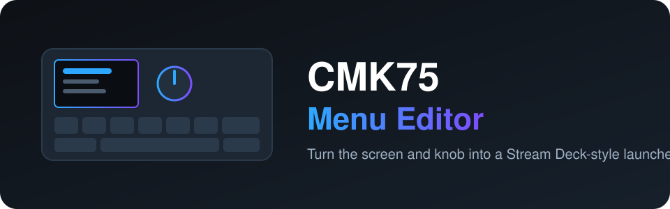
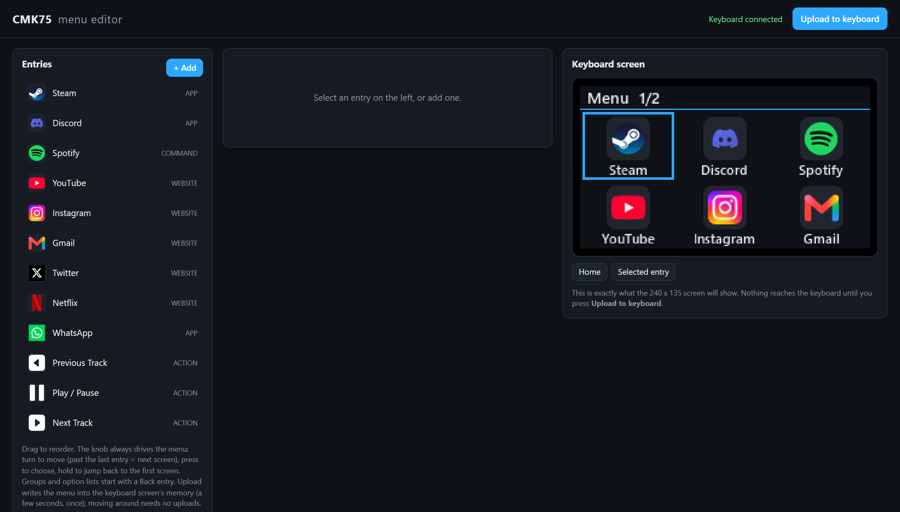

<div align="center">



**Превратите экран и ручку клавиатуры CMK75 в лаунчер в стиле Stream Deck.**

[](LICENSE)


[English](README.md) · [Türkçe](README.tr.md) · [简体中文](README.zh-CN.md) · **Русский** · [한국어](README.ko.md)

</div>

---

<p align="center"></p>

## Что это?

У CMK75 есть небольшой экран 240×135 и поворотная ручка. Проект позволяет собрать меню в браузере и вывести
его на этот экран. Поворот ручки перемещает по меню, нажатие запускает пункт, удержание возвращает на первый экран.

- **Редактор с перетаскиванием:** `http://127.0.0.1:8475/`, с точным предпросмотром экрана
- **Типы пунктов:** приложения, сайты, папки, файлы, команды, встроенные действия и вложенные группы
- **Действия:** запуск или переключение, открытие, открытие в выбранном браузере, закрытие, отключение звука,
  громкость, отправка сочетаний клавиш (например, отключение микрофона и звука в Discord)
- **Свои значки и цвета**, цвета темы, необязательная синхронизация часов
- **Меню хранится в чипе экрана**, поэтому для навигации не нужна повторная загрузка (нужна пропатченная
  прошивка экрана, см. ниже)
- **Инструмент восстановления:** перепрошивает чип экрана, если после обновления экран стал чёрным

## Быстрый старт

> Windows 10/11 и CMK75, подключённая по USB. Python 3.11 или новее.

```powershell
git clone https://github.com/atahan26/cmk75-menu-editor
cd cmk75-menu-editor
py -3.11 -m venv .venv
.venv\Scripts\python.exe -m pip install -r requirements.txt
.venv\Scripts\python.exe menu_app.py
```

Редактор откроется в браузере, при первом запуске создаётся пример меню. Пока вы не нажмёте
**Upload to keyboard**, на клавиатуру ничего не записывается. Остановка: `Ctrl+C`.

## Важно: пропатченная прошивка экрана

Режим с хранением меню в чипе требует **пропатченной прошивки экрана (v17 или новее)**. Файлы прошивок
производителя принадлежат производителю клавиатуры и здесь **не распространяются**. `tools/build_patch.py`
берёт **ваш собственный** файл прошивки экрана и создаёт пропатченную копию, а `tools/recover_screen.py`
её прошивает. Это для опытных пользователей: прошивка может сделать экран неработающим. Прочитайте код,
сделайте резервную копию, используйте только свою клавиатуру и на свой риск.

## Использование с ИИ-агентом

Скопируйте этот блок в Claude Code, Codex, Cursor или другой кодовый агент, открытый в вашем клоне:

```text
Read AGENTS.md and README.md in this repository first. This is a Windows tool for the CMK75
keyboard screen and knob. Help me with: <что вы хотите>. Follow the safety rules in AGENTS.md.
Do not run tools/recover_screen.py or tools/build_patch.py or flash anything without asking me first.
```

## О проекте

Личный проект. Автор поставил цели, определил чипы клавиатуры по открытым фотографиям разборки и проверял
каждую итерацию на реальном устройстве. Код, включая работу с протоколом и сборки прошивки, в основном написан
[Claude Code](https://claude.com/claude-code). Прочитайте код, прежде чем доверять ему свою клавиатуру.

## Лицензия

[MIT](LICENSE). Проект не связан с производителем клавиатуры, не одобрен и не спонсируется им.
Все названия продуктов принадлежат их владельцам.
