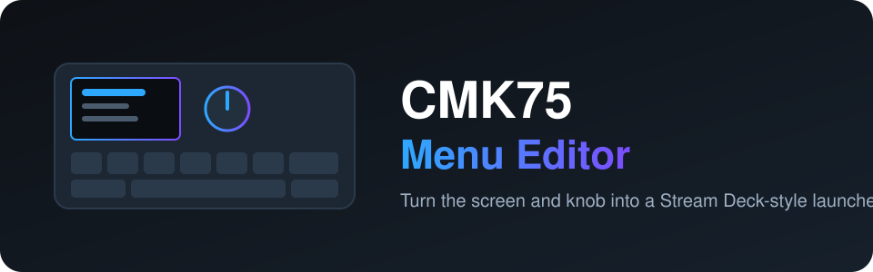
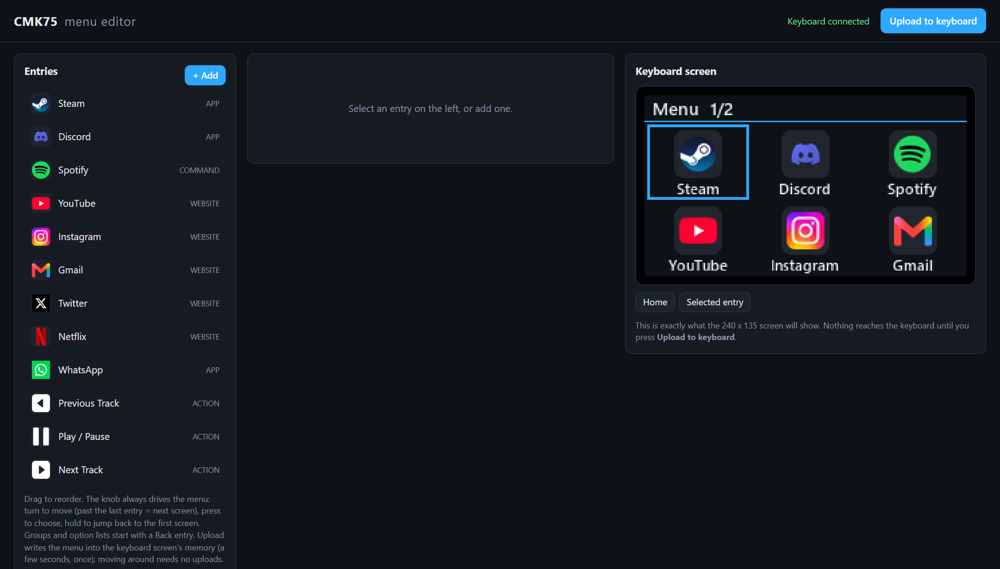

<div align="center">



**CMK75 klavyenin ekranını ve düğmesini Stream Deck tarzı bir başlatıcıya dönüştürün.**

[](LICENSE)


[English](README.md) · **Türkçe** · [简体中文](README.zh-CN.md) · [Русский](README.ru.md) · [한국어](README.ko.md)

</div>

---

<p align="center"></p>

## Nedir?

CMK75'in 240×135 boyutunda küçük bir ekranı ve döner bir düğmesi var. Bu proje, menüyü tarayıcıda tasarlayıp
bu ekrana koymanızı sağlar. Düğmeyi çevirerek gezin, basarak çalıştırın, basılı tutarak ilk ekrana dönün.

- **Sürükle-bırak editör:** `http://127.0.0.1:8475/`, ekranın birebir canlı önizlemesiyle
- **Giriş türleri:** uygulama, web sitesi, klasör, dosya, komut, yerleşik eylemler ve iç içe gruplar
- **Eylemler:** başlat veya geç, aç, seçilen tarayıcıda aç, kapat, sessize al, ses, tuş kombinasyonu gönderme
  (örneğin Discord mikrofon/kulaklık kapatma)
- **Özel ikonlar ve renkler**, tema renkleri, isteğe bağlı saat eşitleme
- **Menü ekran çipinde saklanır**, gezinmek için yeniden yükleme gerekmez (yamalı ekran yazılımı gerekir, aşağıya bakın)
- **Kurtarma aracı:** bir güncelleme ekranı karartırsa ekran çipini yeniden yazar

## Hızlı başlangıç

> Windows 10/11 ve USB ile bağlı bir CMK75. Python 3.11 veya üstü.

```powershell
git clone https://github.com/atahan26/cmk75-menu-editor
cd cmk75-menu-editor
py -3.11 -m venv .venv
.venv\Scripts\python.exe -m pip install -r requirements.txt
.venv\Scripts\python.exe menu_app.py
```

Editör tarayıcıda açılır ve ilk çalıştırmada örnek bir menü oluşturulur. **Upload to keyboard** düğmesine
basmadan klavyeye hiçbir şey gönderilmez. Durdurmak için `Ctrl+C`.

## Önemli: yamalı ekran yazılımı

Menünün çipte saklandığı mod, **yamalı bir ekran yazılımı (v17 veya üstü)** gerektirir. Üretici yazılım
dosyaları klavye üreticisine ait olduğu için burada **dağıtılmaz**. `tools/build_patch.py` **kendi** üretici
ekran yazılımı dosyanızı alıp yamalı bir kopya üretir, `tools/recover_screen.py` ise onu yazar. Bu ileri
düzeydir: yazma işlemi ekranı yanıt vermez hale getirebilir. Kodu okuyun, önce yedek alın, kendi klavyenizde,
kendi sorumluluğunuzda kullanın.

## Yapay zeka ajanıyla kullanım

Bu bloğu klonunuzda açık olan Claude Code, Codex, Cursor veya başka bir kodlama ajanına yapıştırın:

```text
Read AGENTS.md and README.md in this repository first. This is a Windows tool for the CMK75
keyboard screen and knob. Help me with: <ne istediğiniz>. Follow the safety rules in AGENTS.md.
Do not run tools/recover_screen.py or tools/build_patch.py or flash anything without asking me first.
```

## Bu proje hakkında

Kişisel bir proje. Hedefleri yazar belirledi, klavyenin çiplerini herkese açık söküm fotoğraflarından belirledi
ve her sürümü gerçek cihazda test etti. Kodun büyük kısmı, protokol çalışması ve yazılım derlemeleri dahil,
[Claude Code](https://claude.com/claude-code) tarafından yazıldı. Klavyenize güvenmeden önce kodu inceleyin.

## Lisans

[MIT](LICENSE). Klavye üreticisiyle bağlantısı, onayı veya sponsorluğu yoktur. Tüm ürün adları sahiplerine aittir.
