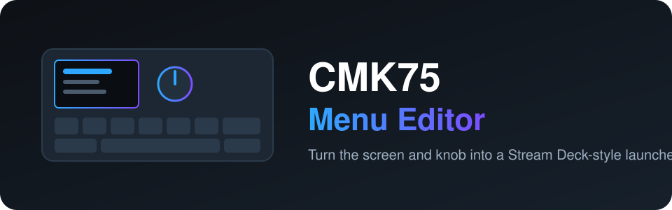
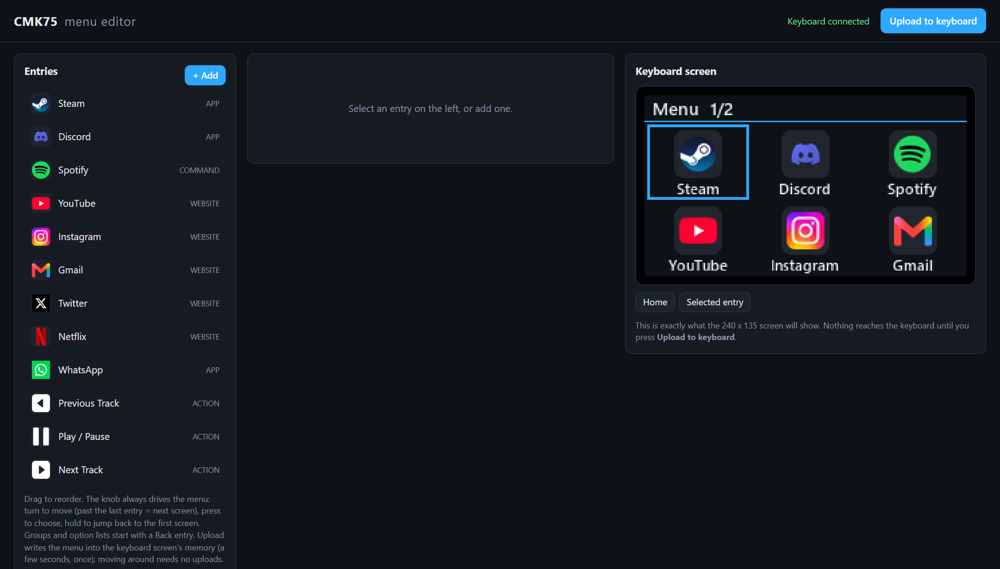

<div align="center">



**把 CMK75 键盘的屏幕和旋钮变成类似 Stream Deck 的启动器。**

[](LICENSE)


[English](README.md) · [Türkçe](README.tr.md) · **简体中文** · [Русский](README.ru.md) · [한국어](README.ko.md)

</div>

---

<p align="center"></p>

## 这是什么？

CMK75 有一块 240×135 的小屏幕和一个旋钮。本项目让你在浏览器中设计菜单，并把它显示在键盘屏幕上。
转动旋钮移动，按下执行，长按回到第一屏。

- **拖放式编辑器**：`http://127.0.0.1:8475/`，实时预览屏幕的真实画面
- **条目类型**：应用、网站、文件夹、文件、命令、内置动作和嵌套分组
- **动作**：启动或切换、打开、用指定浏览器打开、关闭、静音、音量、发送组合键（例如 Discord 静音/关闭收听）
- **自定义图标和颜色**、主题色、可选的时钟同步
- **菜单保存在屏幕芯片中**，浏览时无需重新上传（需要打过补丁的屏幕固件，见下文）
- **恢复工具**：更新后屏幕变黑时，可重新刷写屏幕芯片

## 快速开始

> Windows 10/11，并通过 USB 连接 CMK75。Python 3.11 或更高版本。

```powershell
git clone https://github.com/atahan26/cmk75-menu-editor
cd cmk75-menu-editor
py -3.11 -m venv .venv
.venv\Scripts\python.exe -m pip install -r requirements.txt
.venv\Scripts\python.exe menu_app.py
```

编辑器会在浏览器中打开，首次启动会创建一个示例菜单。在点击 **Upload to keyboard** 之前，不会向键盘写入任何内容。
按 `Ctrl+C` 停止。

## 重要：打过补丁的屏幕固件

“菜单保存在芯片中”的模式需要**打过补丁的屏幕固件（v17 或更高）**。厂商固件文件属于键盘厂商，**不会**在此分发。
`tools/build_patch.py` 会读取**你自己的**厂商屏幕固件文件并生成打过补丁的副本，`tools/recover_screen.py` 负责刷写。
这是高级操作：刷写可能导致屏幕无响应。请先阅读代码并备份，仅用于你自己的键盘，风险自负。

## 与 AI 代理一起使用

把下面这段话复制到在你的克隆目录中打开的 Claude Code、Codex、Cursor 或其他编码代理：

```text
Read AGENTS.md and README.md in this repository first. This is a Windows tool for the CMK75
keyboard screen and knob. Help me with: <你想做什么>. Follow the safety rules in AGENTS.md.
Do not run tools/recover_screen.py or tools/build_patch.py or flash anything without asking me first.
```

## 关于本项目

个人项目。作者确定了目标，通过网上公开的拆机照片识别了键盘的芯片，并在真实设备上测试了每一次迭代。
代码（包括协议部分和固件构建）主要由 [Claude Code](https://claude.com/claude-code) 编写。在把键盘交给它之前，请先审阅代码。

## 许可证

[MIT](LICENSE)。与键盘厂商无关联，未获其认可或赞助。所有产品名称归其各自所有者所有。
